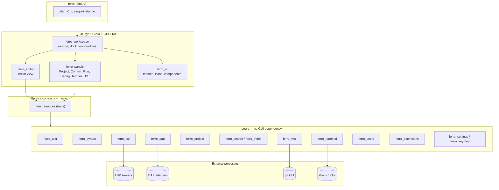
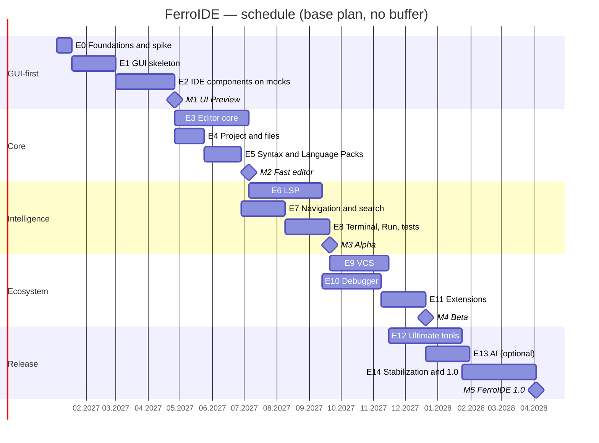

# FerroIDE — plan for building a universal IDE in Rust

> **Plan version:** 1.1 · **Date:** 6 November 2026 · **Status:** proposal for discussion
> Functional inspiration: IntelliJ IDEA (JetBrains) · Performance and window layout inspiration: Zed (zed.dev) · Keyboard shortcuts inspiration: VS Code
>
> **Changes in 1.1:** default keymap follows VS Code conventions (e.g., Ctrl+P instead of Shift, Shift); keymap scheme selectable in settings; placement of windows, panels and icons follows the Zed editor.

---

## Table of contents

1. [Summary](#1-summary)
2. [Vision, goals and principles](#2-vision-goals-and-principles)
3. [Feature map: IntelliJ IDEA → FerroIDE](#3-feature-map-intellij-idea--ferroide)
4. [Technology decisions](#4-technology-decisions)
5. [Architecture](#5-architecture)
6. [Performance "the Zed way"](#6-performance-the-zed-way)
7. [Universality: the Language Packs system](#7-universality-the-language-packs-system)
8. [Roadmap: GUI first, then logic](#8-roadmap-gui-first-then-logic)
9. [Schedule and milestones](#9-schedule-and-milestones)
10. [Quality, testing, CI/CD and distribution](#10-quality-testing-cicd-and-distribution)
11. [Risks and mitigation](#11-risks-and-mitigation)
12. [Team and effort](#12-team-and-effort)
13. [First steps (sprint 0)](#13-first-steps-sprint-0)
14. [Appendices](#appendices)

---

## 1. Summary

**FerroIDE** is one universal IDE for all popular languages (instead of separate applications such as IntelliJ IDEA, PyCharm, WebStorm, GoLand, CLion, Rider, RustRover), written entirely in Rust, with a GPU-rendered interface, running on Linux, Windows and macOS — including on weaker computers.

| Area | Decision |
|---|---|
| **GUI** | GPUI (the UI framework from Zed) + **GPUI Kit 0.9** (ready-made components: dock, tabs, trees, DataTable, virtual lists, code editor) |
| **Window layout** | **Zed style**: slim title bar, three docks (left, right, bottom) toggled by icons in the status bar, minimal chrome, editor-first |
| **Keyboard shortcuts** | **VS Code style** by default (Ctrl+P, Ctrl+Shift+P, Ctrl+.); keymap scheme selectable in settings: VS Code, JetBrains, Zed, Sublime Text, Emacs (+ Vim mode) |
| **Language intelligence** | LSP (Language Server Protocol) + Tree-sitter + DAP (Debug Adapter Protocol) instead of our own analyzers for each language |
| **Order of work** | **GUI-first**: first a complete interface on test data (mocks), then gradually plug in real logic without rewriting views |
| **Performance** | hard budgets (startup, typing latency, memory, FPS) measured in CI, including on a "weak computer" profile |
| **Universality** | **Language Packs** system — a language = manifest + grammar + LSP/DAP servers + run templates; loaded lazily |
| **Extensions** | WebAssembly (wasmtime + Component Model/WIT) with a permission system |
| **Time to 1.0** | about 15 months for the base plan, **about 18 months with a 20% buffer**, team of 4–6 people; first clickable "UI Preview" after about 4 months |

---

## 2. Vision, goals and principles

### 2.1 Goals

- **One IDE for all languages** — Java, Kotlin, Python, JS/TS, Go, Rust, C/C++, C#, PHP, Ruby, SQL, web and configuration files in one application.
- **IntelliJ functionality** — universal search, quick-fixes, refactorings, Run/Debug configurations, extensive VCS support.
- **VS Code keyboard habits** — the default keymap follows VS Code (Quick Open Ctrl+P, Command Palette Ctrl+Shift+P, Quick Fix Ctrl+., Go to Definition F12), so most developers feel at home immediately. Users switching from other tools pick their scheme (JetBrains, Zed, Sublime Text, Emacs, Vim mode) in settings or on the welcome screen.
- **Zed look and layout** — a clean, editor-first window: slim title bar, docks on the left, right and bottom, panel toggle icons in the status bar, no permanent activity bar or tool window stripes.
- **Zed speed** — startup under a second even on weak hardware, instant keyboard response, no JVM and no "indexing that blocks your work".
- **Stability** — a crash of a language server, debugger or extension never closes the IDE.
- **Cross-platform** — identical features on Linux (X11 and Wayland), Windows 10/11 and macOS (Apple Silicon and Intel).

### 2.2 What we deliberately do NOT do in version 1.0 (non-goals)

- **We do not recreate IntelliJ's PSI** (our own semantic model for each language). Analysis depth comes from LSP servers; our own semantic analysis — selectively, after 1.0.
- **We do not copy code, icons, logos or trade names from JetBrains** — we draw inspiration from ergonomics and workflow.
- **We do not copy code from Zed crates licensed under GPL/AGPL** (e.g., the editor, workspace). We use only GPUI and libraries under permissive licenses (Apache-2.0).
- No real-time collaboration, web version or mobile version in 1.0.

### 2.3 Engineering principles

1. **GUI-first on contracts.** Every view depends on service traits (`ProjectService`, `LanguageService`, `VcsService`…). At the beginning they have mock implementations; real logic comes later by swapping implementations, without rewriting the UI.
2. **Logic without GUI.** Logic crates (text, LSP, VCS, search, indexing) do not depend on GPUI → they are testable headless and resilient to a possible change of UI framework.
3. **The UI thread is untouchable.** Zero I/O, zero blocking, zero heavy computation on the UI thread.
4. **Everything is lazy.** Languages, LSP servers, extensions and tool windows are loaded on first use.
5. **Everything is virtualized.** Lists, trees, tables, terminal and editor render only the visible fragment.
6. **We measure, we don't guess.** Every PR goes through benchmarks; a performance regression above 5% blocks the merge.
7. **Every feature is an action.** Everything the user does is an action with an identifier → available in Find Action, in the keymap, in menus and to extensions.

---

## 3. Feature map: IntelliJ IDEA → FerroIDE

Priorities: **P0** — required in Alpha, **P1** — required in 1.0, **P2** — after 1.0 or optional.

| IntelliJ IDEA feature | Implementation in FerroIDE | Priority | Stage |
|---|---|---|---|
| New UI: main toolbar, tool window bars, docking | Zed-style layout: title bar + left/right/bottom docks toggled from the status bar; dock from GPUI Kit + our own `ferro_workspace` | P0 | 1 |
| Keymaps (IntelliJ, VS Code, Eclipse…) | `ferro_keymap`: VS Code scheme by default, scheme selection in settings, keybinding editor with conflict detection | P0 | 1, 2 |
| Editor: tabs, splits, breadcrumbs, gutter, folding | our own `ferro_editor` | P0 | 2–5 |
| Multi-cursor, column selection, Extend Selection | rope + selections; Expand/Shrink Selection (Shift+Alt+→ / ←) via tree-sitter and LSP `selectionRange` | P0 | 3, 5 |
| Syntax highlighting | Tree-sitter + LSP semantic tokens | P0 | 5, 6 |
| Code completion, Parameter Info, Quick Documentation | LSP completion / signatureHelp / hover | P0 | 6 |
| Inspections and quick-fixes (Ctrl+. in the VS Code scheme) | LSP diagnostics + codeAction; linters as additional servers (ruff, clippy, eslint/biome) | P0 | 6 |
| Refactorings (Rename, Extract, Inline, Move) | LSP rename + code actions (scope depends on the server) | P0/P1 | 6 |
| Reformat Code, Optimize Imports | LSP formatting / external formatters, `organizeImports` | P0 | 6 |
| Search Everywhere, Go to File/Class/Symbol/Action | Quick Open (Ctrl+P) with VS Code prefixes (`>` commands, `@` file symbols, `#` workspace symbols, `:` line) + Command Palette (Ctrl+Shift+P); `ferro_search` + fuzzy matching + symbol index | P0 | 7 |
| Find/Replace in Files | ripgrep libraries (`grep-*`, `ignore`) | P0 | 7 |
| Find Usages, Go to Implementation, type and call hierarchies | LSP references / implementation / typeHierarchy / callHierarchy | P0/P1 | 6, 7 |
| Structure, File Structure popup (Ctrl+Shift+O) | LSP documentSymbol, fallback tree-sitter | P0 | 5 |
| Terminal | `alacritty_terminal` + renderer in GPUI | P0 | 8 |
| Run/Debug Configurations, Services | `ferro_tasks` + DAP | P0/P1 | 8, 10 |
| Test runner with result tree | adapters: cargo/nextest, JUnit (Gradle/Maven), pytest, jest/vitest, go test, dotnet test | P1 | 8 |
| Debugger (breakpoints, watches, Evaluate Expression) | `ferro_dap` | P1 | 10 |
| Git: commit, diff, 3-way merge, log with graph, blame, shelve | `gix` (read) + `git` CLI (write and network) | P0/P1 | 9 |
| Local History | file snapshots in SQLite | P1 | 9 |
| Build tools: Maven, Gradle, Cargo, npm, Go, CMake, dotnet | task panels + integration via LSP and CLI | P1 | 8 |
| Live Templates, Postfix Completion | snippet engine (LSP format) + templates per language | P1 | 6 |
| TODO, Bookmarks, Recent Locations | comment scanning (tree-sitter), state in SQLite | P1 | 7 |
| Power Save Mode | "Power save mode" — disables background analyses | P0 | 6 |
| Database Tools (DataGrip) | `sqlx` and other drivers + DataTable from GPUI Kit | P2 | 12 |
| HTTP Client (`.http` files) | `.http` parser + `reqwest` | P1 | 12 |
| Docker / Services | `bollard` | P2 | 12 |
| Markdown preview | Markdown renderer from GPUI Kit | P1 | 12 |
| Plugins (Marketplace) | WASM extensions + registry | P1 | 11 |
| Remote Development (Gateway) | `ferro-server` over SSH | P2 | after 1.0 |
| AI Assistant | optional module, disabled by default | P2 | 13 |

---

## 4. Technology decisions

### 4.1 Choice of GUI framework

| Criterion | **GPUI + GPUI Kit** | Iced 0.14 | Slint 1.x | egui | Floem (Lapce) |
|---|---|---|---|---|---|
| Rendering | GPU: Metal (macOS), DirectX 11 (Windows), wgpu (Linux) | wgpu + software tiny-skia | own (GL/Skia/software) | wgpu/glow, immediate mode | wgpu |
| Proven in a large editor | **Zed** | no IDE of this scale | no IDE | no IDE | Lapce |
| Components needed for an IDE | dock, tabs, tree, DataTable, code editor, virtual lists, Markdown | basic | good widgets, few "IDE" ones | many, but immediate mode | basic |
| Rendering large texts | very good | good (cosmic-text) | good | average | good |
| API stability | low (pre-1.0), mitigated by GPUI Kit | medium | high | medium | low |
| License | Apache-2.0 | MIT | GPL / royalty-free / commercial | MIT/Apache | MIT |

**Decision: GPUI + GPUI Kit.** It is the shortest path to Zed-class performance, and GPUI Kit provides most of the "building blocks" of a Zed-style IDE interface: a dock with serialized layout and draggable tabs, virtual lists and tables (hundreds of thousands of rows), a code editor with Tree-sitter and LSP, accessibility via AccessKit, and UI tests in headless windows.

**Plan B (decision after Stage 0):** Iced 0.14+. If GPUI does not meet the budgets on the reference weak hardware (e.g., driver problems), Iced offers the tiny-skia software renderer, which works without a GPU. Thanks to the "logic without GUI" principle, the change would affect only the view layer.

**Important technical facts (as of November 2026):**

- On Linux, since February 2026 GPUI renders through **wgpu** (it replaced the blade library), which improved compatibility, among others, with NVIDIA and Wayland compositors. On macOS the native Metal renderer remains.
- `gpui-kit` pins a compatible GPUI version and re-exports GPUI, `gpui-base` and `gpui-component` — the application has **one UI dependency**, which reduces the risk of breaking changes.
- GPUI has its own async executor. Logic therefore uses `smol`/`futures`; libraries that require Tokio (`sqlx`, `reqwest`, `bollard`) run in a **separate Tokio runtime** on background threads.
- Optional `gpui-fast` variant (a feature in GPUI Kit) — to be evaluated in the performance spike.

### 4.2 Library stack

Legend: ✔ — version verified in November 2026. Others are added with `cargo add` (which fetches the latest stable release) and pinned in `Cargo.lock`.

| Area | Library | Version | Notes |
|---|---|---|---|
| Language | Rust stable, edition 2024 | 1.99.x ✔ | `rust-toolchain.toml`, bumped every 1–2 releases |
| GUI | `gpui-kit` (GPUI + gpui-base + gpui-component) | 0.9.x ✔ | one UI dependency |
| Icons | Lucide (bundled with GPUI Kit) + our own file-type icons | — | no JetBrains assets |
| Text buffer | `ropey` → later our own rope based on SumTree | 1.x | anchors, multi-buffer |
| Syntax | `tree-sitter`, `tree-sitter-highlight`, `tree-sitter-*` grammars | 0.26.x ✔ | native or WASM grammars |
| LSP | `lsp-types` + our own JSON-RPC client (`serde_json`) | latest | full control of cancellation and queues |
| DAP | types generated from the DAP JSON schema | — | |
| Async | `smol`, `futures`, `async-process`, `async-channel`; `tokio` 1.x only in background | — | |
| File system | `notify` + `notify-debouncer-full`, `ignore`, `memmap2`, `trash`, `encoding_rs` | — | |
| Search | `grep-searcher`, `grep-regex`, `ignore`, `nucleo` (fuzzy) | — | nucleo: MPL-2.0 license |
| Diff and merge | `imara-diff` | — | fast histogram algorithm |
| Git | `gix` (gitoxide) + `git` CLI | 0.84+ ✔ | gix: status/log/blame/diff; CLI: push/pull/rebase |
| Terminal | `alacritty_terminal` | — | ConPTY on Windows |
| Extensions | `wasmtime` (LTS release), `wit-bindgen` (SDK) | — | Component Model + WASI |
| Local database | `rusqlite` (feature `bundled`) | — | workspace state, index, Local History |
| Settings | `serde`, `toml`, `schemars` (JSON Schema) | — | |
| HTTP | `reqwest` (rustls) | — | downloading LSP servers, HTTP Client |
| Databases | `sqlx` (PostgreSQL/MySQL/SQLite), `tiberius` (MSSQL) | — | Stage 12 |
| Docker | `bollard` | — | Stage 12 |
| i18n | `fluent-bundle` (Project Fluent) | — | Polish and English from the start |
| Logs and profiling | `tracing`, `tracing-subscriber`, Tracy (`tracing-tracy`) | — | |
| Errors | `anyhow`, `thiserror` | 1.x / 2.x | |
| Allocator | `mimalloc` | — | |
| Crash reports | `crash-handler` + `minidumper` (opt-in) | — | |
| Testing | `cargo-nextest`, `insta`, `proptest`, `divan` | — | |
| Distribution | `dist` (formerly cargo-dist) + code signing | — | |

### 4.3 Dependency policy

- `Cargo.lock` in the repository; bulk updates every 2 weeks (Renovate or Dependabot).
- GPUI Kit update once per quarter, in a separate branch, with the full set of performance tests.
- `cargo-deny`: allowed licenses (MIT, Apache-2.0, BSD, ISC, Zlib, MPL-2.0, Unicode-3.0), GPL/AGPL blocked, RustSec vulnerability audit.
- Release builds must be possible offline (`cargo vendor` for releases).

---

## 5. Architecture

### 5.1 Layers



### 5.2 Repository structure (Cargo workspace)

```text
ferroide/
├── Cargo.toml                # [workspace], shared dependencies and profiles
├── rust-toolchain.toml
├── deny.toml                 # licenses and security audit
├── crates/
│   ├── ferro/                # binary: start, CLI arguments, single-instance
│   ├── ferro_ui/             # themes, icons, typography, shared components
│   ├── ferro_workspace/      # window, dock, tool windows, tabs, splits, status bar
│   ├── ferro_editor/         # editor view: rendering, gutter, cursors, inlay hints
│   ├── ferro_panels/         # tool windows: Project, Commit, Run, Debug, Problems…
│   ├── ferro_storybook/      # gallery of FerroIDE components on mocks
│   ├── ferro_services/       # service traits + mock implementations + data generators
│   ├── ferro_text/           # rope, transactions, undo/redo, anchors, selections
│   ├── ferro_syntax/         # tree-sitter: highlight, outline, folding, indentation
│   ├── ferro_languages/      # Language Packs registry, language detection
│   ├── ferro_lsp/            # LSP client, server manager and installer
│   ├── ferro_dap/            # DAP client
│   ├── ferro_project/        # file tree, watcher, .gitignore, file operations
│   ├── ferro_search/         # Quick Open, Command Palette, Find in Files, fuzzy
│   ├── ferro_index/          # persistent file and symbol index (SQLite)
│   ├── ferro_vcs/            # git: status, diff, log, blame, commit, merge
│   ├── ferro_terminal/       # terminal emulation
│   ├── ferro_tasks/          # Run Configurations, tasks, test runner
│   ├── ferro_settings/       # settings (TOML + JSON Schema), migrations
│   ├── ferro_keymap/         # keymap schemes: VS Code (default), JetBrains, Zed, Sublime, Emacs; Vim mode
│   ├── ferro_extensions/     # WASM host (wasmtime), permissions
│   ├── ferro_extension_api/  # SDK for extension authors (WIT)
│   ├── ferro_db/             # workspace state, Local History (SQLite)
│   ├── ferro_tools_http/     # HTTP Client (.http)
│   ├── ferro_tools_db/       # Database Tools
│   └── ferro_perf/           # benchmarks, large-project generators
├── languages/                # built-in Language Packs (manifests + .scm queries)
├── assets/                   # fonts, icons, themes, translations (.ftl)
├── docs/adr/                 # Architecture Decision Records
└── xtask/                    # build, packaging, benchmarks
```

### 5.3 GUI-first: the contracts-and-mocks pattern

This is the key mechanism that lets us build the whole interface first and only then "wire it up" with logic.

```rust
// ferro_services/src/project.rs — contract sketch
pub trait ProjectService: Send + Sync + 'static {
    fn roots(&self) -> Vec<PathBuf>;
    fn children(&self, dir: &Path) -> BoxFuture<'static, Result<Vec<Entry>>>;
    fn read_file(&self, path: &Path) -> BoxFuture<'static, Result<Rope>>;
    fn subscribe(&self) -> async_channel::Receiver<ProjectEvent>; // added/removed/changed
}

// Stages 1–2: synthetic data, including extreme cases (100,000 files, long names,
// emoji, deep nesting), with simulated latency and errors.
pub struct MockProjectService {
    tree: SyntheticTree,
    latency: Duration,
    failure_rate: f32,
}

// Stage 4: real implementation — views remain unchanged.
pub struct FsProjectService { /* notify, ignore, memmap2 */ }
```

In the same way we create: `LanguageService` (mock: random diagnostics, suggestions and hover), `VcsService` (mock: fictional commit history with branches), `RunService`, `DebugService` (mock: artificial call stack and variables), `TerminalService`, `SearchService`. Mocks simulate delays and errors, so "loading", "empty" and "error" states are designed from day one, and UI performance tests run on data larger than in real projects.

### 5.4 Threading model

- **Main thread (UI):** layout, rendering and events only. Frame budget: 8.3 ms (120 Hz) / 16.6 ms (60 Hz).
- **Background executor (GPUI):** tree-sitter parsing, fuzzy matching, diff, file scanning, indexing at low priority.
- **Separate Tokio runtime (1–2 threads):** network, databases, Docker.
- **External processes:** LSP servers, DAP adapters, git, PTY. A process failure ends with a notification and an automatic restart, never with an IDE crash.
- **Cancellation:** every task has a cancellation token; a new edit immediately cancels outdated requests (completion, hover, semantic tokens, inlay hints).

### 5.5 Editor model

- **Buffer:** rope (insertion and deletion in O(log n)), cheap immutable snapshots passed to background threads.
- **Anchors:** positions that survive edits — for diagnostics, breakpoints, bookmarks and comments.
- **Transactions:** undo/redo grouped by time, separate undo for selections.
- **Display map (layers):** folds → soft wrap → inlay hints → tab expansion; updated incrementally.
- **Large files:** above 20 MB a "large file" mode (memmap, highlighting only the visible range, no LSP); above 500 MB read-only preview only.

---

## 6. Performance "the Zed way"

### 6.1 Hardware profiles

| Profile | CPU | RAM | GPU | Disk |
|---|---|---|---|---|
| **Weak (reference)** | 2 cores / 4 threads (e.g., Core i3 7th gen, Celeron N5105) | 4 GB | Intel UHD 600/620 | SATA SSD |
| **Medium** | 6–8 cores | 16 GB | newer integrated graphics | NVMe |

In CI we reproduce the weak profile with a virtual machine limited to 2 vCPUs and 4 GB RAM, and once a week we test on a physical, old laptop.

### 6.2 Performance budgets

| Metric | Medium profile | Weak profile | How we measure |
|---|---|---|---|
| Cold start to an interactive window | < 400 ms | < 1 s | log markers + Tracy |
| Key press → pixel (p99) | < 8 ms | < 16 ms | automated test with timestamps |
| Scrolling a 100k-line file | 120 FPS | 60 FPS | frame counter in diagnostic mode |
| Opening a 50 MB file | < 300 ms | < 1 s | benchmark |
| Quick Open (Ctrl+P), 100k files (result per keystroke) | < 30 ms | < 60 ms | benchmark |
| Find in Files, 1 GB repository | < 1 s | < 3 s | benchmark |
| Memory: empty window | < 120 MB | < 120 MB | RSS |
| Memory: medium project (without LSP processes) | < 300 MB | < 300 MB | RSS |
| Installer size | < 60 MB | — | CI |

### 6.3 Optimization techniques

**Rendering**
- GPU rendering with a glyph atlas and a line layout cache; we redraw only views marked as changed.
- Virtualization of all lists, trees and tables (e.g., `uniform_list` in GPUI, virtual lists and DataTable from GPUI Kit).
- Short animations that can be disabled; no blur effects on the weak profile.

**Data and analysis**
- Incremental tree-sitter parsing; highlighting only the visible range plus a margin.
- Debounce for "cosmetic" queries (semantic tokens, inlay hints, code lens: 100–200 ms); completion immediately, with cancellation of previous requests.
- Background indexing at low priority, paused while typing.

**Laziness**
- The window is shown immediately with the saved layout, the project is rebuilt in the background; no synchronous I/O before the first frame.
- Language Pack and LSP server start only when the first file of a given language is opened; tool windows are created on first opening.

**Memory — LSP governor**
- Language servers (e.g., jdtls, rust-analyzer) use the most RAM, not the IDE itself. Therefore: a limit on simultaneously running servers, stopping unused ones after N minutes, showing each server's memory usage in the status bar, and the option to choose lighter alternatives.

**Power save mode (equivalent of IntelliJ's Power Save Mode)**
- Disables animations, semantic tokens, inlay hints, background analyses and automatic indexing. It can turn on automatically on battery or on the weak profile.

**Compilation**
- Release profile: `lto = "fat"`, `codegen-units = 1`, `opt-level = 3`, `debug = "line-tables-only"` (symbolication of crash reports), mimalloc allocator.
- Optionally PGO (`cargo-pgo`) before stable releases.

**Rendering fallbacks**
- Windows: DirectX 11 (to be verified in the spike: software WARP for machines without a GPU and for remote desktops).
- Linux: wgpu with Vulkan (to be verified: fallback to OpenGL for older GPUs).
- macOS: Metal.
- A setting forcing a specific backend and GPU (e.g., on laptops with two graphics cards).

---

## 7. Universality: the Language Packs system

### 7.1 Concept

In IntelliJ every ecosystem is a separate product. In FerroIDE **every language is a Language Pack**: a TOML manifest + tree-sitter queries (`.scm`) + configuration of LSP servers, debugger, formatters, run templates and test frameworks. The most popular packs are built in; the others are downloaded on demand from a registry (from Stage 11 as WASM extensions). One file can have several servers at once (e.g., Python: basedpyright + ruff).

Example manifest: [Appendix B](#appendix-b-language-pack-manifest).

### 7.2 Starter packs (tier 1)

| Language | LSP server | Debugger (DAP) | Formatter / linter | Tests / build |
|---|---|---|---|---|
| Rust | rust-analyzer | CodeLLDB | rustfmt, clippy | cargo, nextest |
| Java | Eclipse JDT LS | java-debug (jdtls extension) | google-java-format (option) | Maven, Gradle, JUnit |
| Kotlin | Kotlin LSP from JetBrains (open source; assess maturity) or kotlin-language-server | java-debug | ktlint / ktfmt | Gradle |
| Python | basedpyright + ruff | debugpy | ruff format | pytest, uv/pip |
| TypeScript / JavaScript | vtsls or typescript-language-server; eslint or biome | js-debug | prettier / biome | npm/pnpm/yarn, vitest/jest |
| Go | gopls | delve | gofmt (via gopls) | go test |
| C / C++ | clangd | CodeLLDB, GDB (native DAP since GDB 14) | clang-format, clang-tidy | CMake, Make |
| C# | Roslyn LSP or csharp-ls | netcoredbg | dotnet format | dotnet test |
| PHP | Phpactor (open source); Intelephense optionally | Xdebug via php-debug | php-cs-fixer | PHPUnit, Composer |
| Ruby | ruby-lsp | rdbg | rubocop | rspec, minitest |
| Web | vscode-langservers-extracted (HTML/CSS/JSON), Tailwind CSS LSP | js-debug | prettier / biome | — |
| Configuration and documents | yaml-language-server, taplo (TOML), marksman (Markdown) | — | — | — |
| SQL | Postgres Language Server, sqls | — | — | — |
| Shell | bash-language-server | — | shfmt, shellcheck | — |

> License note: the debugging adapter from the Microsoft C/C++ extension (cpptools) is licensed only for Microsoft products — that is why for C/C++ we use CodeLLDB and GDB.

### 7.3 Tool management

- **Server installer:** downloads from official sources (GitHub Releases, npm, PyPI, NuGet), verifies checksums, installs into the FerroIDE data directory. If a compatible version of the tool is already on the system — it uses it.
- **Managed environments:** Node.js (for servers written in JS), JDK (detection of `JAVA_HOME`, SDKMAN, download of Temurin on request), Python interpreters (venv, uv, conda).
- **Project detection:** `Cargo.toml`, `pom.xml`, `build.gradle(.kts)`, `package.json`, `pyproject.toml`, `go.mod`, `CMakeLists.txt`, `*.csproj`/`*.sln`, `composer.json`, `Gemfile` → automatic activation of packs and suggestions for run configurations.
- **Fallback without LSP:** tree-sitter provides highlighting, file structure, folding, in-file navigation and a simple symbol index. The IDE is useful immediately, before the server has time to start — and it keeps working when the server crashes.

---

## 8. Roadmap: GUI first, then logic

Stages 0–2 build a **complete, clickable interface on mocks**. From Stage 3 onward, the services get real implementations, while the views stay the same.

```text
 Stage:  0   1   2 │ 3   4   5 │ 6   7   8 │ 9  10  11 │ 12  13  14
         └─ GUI ───┘ └─ core ──┘ └─ IDE ───┘ └ ecosys. ┘ └─ release ┘
 Data:   mocks ────▶ real files ▶ real LSP ▶ git/DAP ▶ everything
```

---

### Stage 0 — Foundations and technology spike (2 weeks)

**Goal:** confirm that the chosen stack meets the budgets on three systems and on weak hardware.

**Scope:**
- Repository, Cargo workspace, `rust-toolchain.toml`, `deny.toml`, issue/PR templates, commit convention.
- CI: Linux x64, Windows x64, macOS arm64 and x64; `clippy`, `rustfmt`, `nextest`, `cargo-deny`.
- GPUI Kit spike: a window + dock with three panels, a list of 1 million items, the GPUI Kit code editor with a 100k-line file.
- Measurements: startup time, RAM, FPS, typing latency — on all systems and on the weak profile.
- Rendering test: older Intel HD, NVIDIA, X11 and Wayland, remote desktop (RDP), virtual machine.
- ADR-001…005: GUI framework, async model, settings format, project license, extension strategy.

**Definition of Done:** spike report and a go/no-go decision for GPUI (in case of no-go: Plan B with Iced).

---

### Stage 1 — GUI skeleton: appearance and layout in the style of Zed (6 weeks)

**Goal:** a complete skeleton of the IDE window, fully navigable with mouse and keyboard, based solely on mocks. Window, panel and icon placement follows the Zed editor: minimal chrome, the editor takes most of the space, panels live in three docks and are toggled with icons in the status bar.

**Scope:**
- **Window:** one window = one project, multiple windows at the same time; client-side decorations on Linux, native window buttons on macOS (left) and Windows (right).
- **Title bar (Zed style, slim, single row):** on the left — application menu (hamburger on Windows/Linux), project picker (`demo-app ▾`, opens recent projects), branch picker (`main ▾`); on the right — run configuration selector with Run/Debug/Stop icons (FerroIDE addition), notification bell, user/settings menu. No separate main toolbar row.
- **Docks (Zed model):** three docks — **left** (Project, Git/Commit, Outline/Structure, Database), **right** (AI Agent, Notifications, Debug details), **bottom** (Terminal, Run, Debug console, Problems, TODO). Each dock shows one panel at a time; panel position can be changed (right-click on the icon → "Dock left / right / bottom"); docks are resizable, zoomable (maximize panel to the whole window) and their layout is remembered per project. No permanent tool window stripes or activity bar along the window edges.
- **Status bar = panel switcher (as in Zed):** left part — toggle icons for the left dock panels, diagnostics counter (errors/warnings → opens Problems), background activity indicator (LSP, indexing); right part — cursor position, selection size, indentation, encoding, line separator, language, LSP server status, memory indicator, then toggle icons for the bottom and right dock panels.
- **Editor area (panes):** each pane has its own tab bar with Back/Forward arrows on the left and icons on the right (`+` new file/terminal, split, pane menu); tabs with pinning, preview tab (italic, replaced by the next single-click open — as in VS Code/Zed), horizontal and vertical splits, dragging tabs between panes; breadcrumbs and editor toolbar (search, quick actions) above the text.
- **Action system and keymap:** action registry (every feature has an ID); **default keymap in the VS Code style**; Command Palette (Ctrl+Shift+P) and Quick Open (Ctrl+P). Keymap scheme chosen in settings (see Stage 2 and [Appendix C](#appendix-c-keymap-schemes-and-default-shortcuts-vs-code-style)).
- **Themes:** Ferro Dark, Ferro Light, High Contrast; semantic color tokens; switching without restart; UI and font size scaling.
- **Welcome screen (as in Zed onboarding):** recent projects, New / Open / Clone repository (on mocks) and a first-run section "Choose theme" and **"Choose keymap"** (VS Code, JetBrains, Zed, Sublime Text, Emacs; Vim mode toggle).
- **Menu:** native global menu on macOS, compact application menu in the title bar on Windows/Linux.
- **i18n:** Project Fluent, Polish and English from the first screen.
- **`ferro_storybook`:** a gallery of all FerroIDE components with data from mocks.

Target window layout (sketch, Zed style):

```text
┌──────────────────────────────────────────────────────────────────────────┐
│ =  demo-app v  ⎇ main v                     [App v] (>) (D) (#)   (!) (@) │ title bar
├────────────────────┬────────────────────────────────────────┬────────────┤
│ demo-app           │ < > │ main.rs x │ lib.rs │ Cargo.toml  + || │ Agent      │
│ v src              │ src > main.rs > fn main                │            │
│     main.rs        │  1  fn main() {                        │  (right    │
│     lib.rs         │  2      println!("Hello, FerroIDE");   │   dock)    │
│   Cargo.toml       │  3  }                                  │            │
│   (left dock)      │                                        │            │
├────────────────────┴────────────────────────────────────────┴────────────┤
│ Terminal 1 x │ +                                             [ ] x        │ bottom dock
│ $ cargo run                                                               │
├──────────────────────────────────────────────────────────────────────────┤
│ [P][G][O]  x0 !2  (rust-analyzer)    2:14  4 spaces  UTF-8  LF  Rust  [T][R][A] │ status bar
└──────────────────────────────────────────────────────────────────────────┘
 Title bar: = app menu, project picker, branch picker, run configuration
            with Run (>) / Debug (D) / Stop (#), notifications (!), user/settings (@)
 Pane tab bar: < > back/forward, + new, || split
 Status bar, left:  P = Project, G = Git, O = Outline (left dock); x0 !2 = errors/warnings
 Status bar, right: T = Terminal, R = Run/Debug (bottom dock), A = AI Agent (right dock)
```

**Definition of Done:** complete window layout on three systems; theme switch < 50 ms; no frame drops when dragging and resizing docks on the weak profile; headless UI tests for docks, status bar toggles and tabs.

---

### Stage 2 — IDE components on mocks (8 weeks)

**Goal:** all main IDE views exist and work on synthetic data — with full handling of loading, empty and error states.

**Scope:**
- **Project tool window:** virtual tree (1 million nodes), file-type icons, context menu, drag & drop, "Select Opened File", speed search (typing filters the tree).
- **Editor — view layer:** text rendering with highlighting from the mock, gutter (line numbers, VCS change markers, breakpoints, ▶ icons at `main` and tests), breadcrumbs, sticky lines, inlay hints, diagnostic underlines, popups: completion, Quick Documentation, Parameter Info, Quick Fix menu (Ctrl+.). To start, we can rely on the code editor from GPUI Kit, ultimately replacing it with our own `ferro_editor`.
- **Quick Open (Ctrl+P) and Command Palette (Ctrl+Shift+P)** — a single centered popup at the top of the window (VS Code/Zed style) with prefixes: none = files, `>` = commands/actions, `@` = symbols in the file, `#` = workspace symbols, `:` = go to line, `%` = text search; recently used items first, result preview.
- **Settings window:** category tree, search within settings, field editors, Apply / Reset; option to open the raw `settings.toml` file (as in Zed/VS Code).
- **Keymap settings page:** **keymap scheme selector** (VS Code — default, JetBrains, Zed, Sublime Text, Emacs) + **Vim mode** toggle; keybinding table with search by action name or by pressed keys, editing and resetting a single binding, conflict detection and marking of user overrides; switching the scheme applies immediately without restart and keeps user overrides; separate macOS variants of each scheme (Cmd instead of Ctrl).
- **Tool windows:** Problems, Terminal (static rendering), Run and Debug (console, test tree, variables, call stack), Commit (list of changes, checkboxes, message field), Git Log (commit graph), Structure, TODO, Notifications, Services.
- **Diff viewer** (side-by-side and unified) and **3-way merge** on static data.
- **Dialogs:** Rename with preview, Find in Files with preview, New File/Class, Run Configuration editor, Clone Repository.
- **Accessibility:** full keyboard navigation, AccessKit labels, contrast checks.

**Definition of Done — milestone M1 "UI Preview":** complete, clickable IDE on mocks; headless UI tests for key interactions; every view fits within the frame budget with data 10× larger than typical.

---

### Stage 3 — Editor core (10 weeks)

**Goal:** a production-class text editor — fast, correct and resilient to large files.

**Scope:**
- **`ferro_text`:** rope, transactions, undo/redo, anchors, multi-cursor (Ctrl+D next occurrence, Ctrl+Shift+L all occurrences, Alt+click, Ctrl+Alt+↑/↓), column selection, clipboard with multiple cursors, find/replace in file (regex), line duplication and moving, commenting consistent with the Language Pack.
- **Unicode and input:** IME (CJK), Polish characters via AltGr, grapheme clusters, emoji, wide characters, basic bidirectional text support.
- **View formatting:** soft wrap, indentation, visible whitespace, tabs, encoding detection (`encoding_rs`) and line separators.
- **Saving:** atomic (temporary file + rename), autosave as in IntelliJ (save on focus loss), detection of external changes with the option to reload or compare.
- **Performance:** incremental display map; "large file" mode.
- **Vim mode** — preparation in the action system, implementation as P2.

**Definition of Done:** property-based tests (`proptest`) for rope and undo; fuzzing of editing operations; typing latency within budget on a 100k-line file on the weak profile.

---

### Stage 4 — Project, files and state (4 weeks, in parallel with Stage 3)

**Goal:** a real file system and persistent work state instead of mocks.

**Scope:**
- **`FsProjectService`:** background scanning with `ignore` (respects `.gitignore`), `notify` watcher with a debouncer, file operations (new, rename, move, delete to the system trash).
- **Workspace state in SQLite:** open files, window layout, cursor positions, navigation history (Back/Forward: Alt+← / Alt+→), recent files (Ctrl+Tab, Ctrl+P), Recent Locations.
- **Settings:** global and project-level (`.ferroide/settings.toml`), JSON Schema with suggestions, live reload, migrations between versions.
- **Keymap persistence:** selected scheme stored in `settings.toml` (`[keymap] base = "vscode"`), user overrides in a separate `keymap.toml`, live reload after editing the file (example in [Appendix C](#appendix-c-keymap-schemes-and-default-shortcuts-vs-code-style)).
- **Multiple root directories** in one window (equivalent of modules).
- **Trusted projects:** asking for trust before running scripts, tasks and LSP servers from an unknown repository.

**Definition of Done:** a 100k-file project opens in < 1 s (first tree level immediately); changes on disk visible in the IDE within < 200 ms.

---

### Stage 5 — Syntax and Language Packs v1 (5 weeks)

**Goal:** highlighting, structure and basic "intelligence" for a dozen or so languages — without any LSP server.

**Scope:**
- **`ferro_syntax`:** tree-sitter 0.26, incremental parsing, highlight queries, injected languages (HTML + JS + CSS, code blocks in Markdown, SQL in strings).
- File structure, code folding, bracket matching, auto-pairs, smart indentation, Expand/Shrink Selection (Shift+Alt+→ / Shift+Alt+←).
- **`ferro_languages`:** manifest, language detection (extension, file name, shebang, modeline), registry of built-in packs, grammars loaded on demand (also as WASM).
- **Fallback navigation:** symbol index from `tags.scm` queries, ▶ icons from `runnables.scm` queries.

**Definition of Done — milestone M2 "Fast editor":** 15+ languages with highlighting; incremental parsing < 2 ms per edit in a 10k-line file (medium profile); FerroIDE is suitable for everyday editing as a fast editor.

---

### Stage 6 — Code intelligence via LSP (10 weeks)

**Goal:** the full programmer "inner loop": suggestions, navigation, diagnostics, quick-fixes and refactorings.

**Scope:**
- **`ferro_lsp`:** JSON-RPC over stdio, queues, cancellation, timeouts, restart after a crash, multiple servers per file, push and pull diagnostics, `workspace/configuration`, client-side file watching.
- **Editor features:** completion (with resolve, snippets and auto-import), Quick Documentation, Parameter Info, Go to Declaration / Type / Implementation, Find Usages with preview, Rename with change preview (F2), Quick Fix / code actions (Ctrl+.), formatting (document / range / on typing), Optimize Imports, inlay hints, semantic tokens, document and workspace symbols, call and type hierarchies, code lens, links in documents.
- **Inspections:** Problems panel (file / project, Ctrl+Shift+M), F8 / Shift+F8 navigation between problems, linters as additional servers.
- **Live Templates and Postfix Completion:** snippet engine compatible with the LSP format + built-in templates for each language.
- **Server installer, LSP memory manager and power save mode.**

**Definition of Done:** complete inner loop in Rust, Java, Python, TypeScript and Go; integration tests with real servers in CI (container images with servers installed).

---

### Stage 7 — Navigation and search (6 weeks, partly in parallel with Stage 6)

**Goal:** searching for "everything" instantly, even in very large repositories.

**Scope:**
- **Quick Open and Command Palette on real data:** files (nucleo), classes and symbols (index + LSP `workspace/symbol`), actions, settings, text.
- **Find / Replace in Files:** ripgrep libraries, regex, file masks, scopes (project, directory, scope), preview and replace with the ability to undo in one operation.
- **`ferro_index`:** persistent file and symbol index in SQLite, updated incrementally in the background and paused while typing; optional trigram index for repositories above a few GB.
- **TODO panel, Bookmarks (Ctrl+Alt+K), Recent Locations.**

**Definition of Done:** the budgets from §6.2 for Quick Open and Find in Files are met on both profiles.

---

### Stage 8 — Terminal, running and testing (6 weeks)

**Goal:** building, running and testing without leaving the IDE.

**Scope:**
- **`ferro_terminal`:** `alacritty_terminal` + GPUI renderer, multiple tabs, shell selection (bash, zsh, fish, PowerShell, cmd), clickable file paths, shell integration (OSC 133: command boundaries, exit codes).
- **`ferro_tasks`:** Run Configurations (TOML files in `.ferroide/run/`, committable), templates per language and build tool, environment variables, `.env` files, "before launch" tasks, compound configurations.
- **Build tools:** Cargo, Maven, Gradle, npm/pnpm/yarn, Go, CMake, dotnet — panels with a task list (like the Gradle/Maven tool window).
- **Test runner:** result tree, navigation to a test, rerunning failed ones, ▶ icons in the gutter.
- **Console:** ANSI colors, clickable stack traces (Java, Kotlin, Python, Rust, JS/TS, Go, C#), filtering and search.

**Definition of Done — milestone M3 "Alpha":** daily work in five languages (Rust, Java, Python, TypeScript, Go) without leaving the IDE.

---

### Stage 9 — Version control (8 weeks)

**Goal:** Git support at the IntelliJ level.

**Scope:**
- **Backend:** reading via `gix` (status, diff, log, blame), writing and network operations via the `git` CLI (commit, push, pull, fetch, rebase, cherry-pick); authentication through system mechanisms (credential helpers, ssh-agent).
- **UI:** change markers in the gutter with hunk revert, Commit tool window (changelists, partial commits of individual lines), diff, 3-way merge with conflict resolution, Log with graph and filters, Annotate (blame), branch widget in the toolbar, stash and shelf, cherry-pick / revert / reset from the UI.
- **Local History:** file snapshots on save and on bulk operations (SQLite, with a size limit).
- **Hosting integrations (P2):** GitHub and GitLab — pull/merge requests, review.

**Definition of Done:** all typical Git workflows without a terminal; a log of 100k commits scrolls smoothly on the weak profile.

---

### Stage 10 — Debugger (8 weeks)

**Goal:** debugging in the main languages with IntelliJ ergonomics.

**Scope:**
- **`ferro_dap`:** launch and attach, breakpoints (conditional, logpoints, on exceptions), Step Over / Into / Out, Run to Cursor, threads, call stack, variables (lazily expanded), watches, Evaluate Expression (in the Debug Console and via hover), inline values in the editor, debugger console.
- **Adapters:** CodeLLDB, GDB (native DAP), debugpy, java-debug, js-debug, delve, netcoredbg.
- Debug configurations integrated with Run Configurations.

**Definition of Done:** debugging works in at least six languages; an adapter crash does not affect IDE stability.

---

### Stage 11 — Extension system (6 weeks)

**Goal:** an extension ecosystem without risk to stability and performance.

**Scope:**
- **Host:** `wasmtime` + Component Model; API described in WIT: registration of Language Packs, LSP/DAP adapters, actions, themes, snippets, run templates and data-driven panels (without arbitrary GUI code).
- **Security:** per-extension permissions (network, process spawning, file system) with user approval; memory and time limits; an extension crash does not affect the IDE.
- **Registry:** index in a Git repository, package signatures, background updates.
- **SDK:** crate `ferro_extension_api`, project template, documentation.

**Definition of Done — milestone M4 "Beta":** three sample extensions (a language, a theme, a tool); at least five built-in Language Packs migrated to the extension format.

---

### Stage 12 — "Ultimate" class tools (10 weeks)

**Goal:** features that in the JetBrains ecosystem are paid versions or separate products.

**Scope:**
- **Database Tools:** connections (PostgreSQL, MySQL/MariaDB, SQLite, MSSQL), schema explorer, SQL console with schema-based suggestions, results in DataTable with virtual scrolling, data editing, CSV/JSON export.
- **HTTP Client:** `.http` / `.rest` files, environment variables, request history, highlighted responses.
- **Docker / Services:** containers, logs, images (`bollard`).
- **Markdown:** live preview next to the editor; Mermaid diagrams (P2).
- **Remote development (P2, preparation):** architecture of `ferro-server` run over SSH.

**Definition of Done:** each tool loads lazily and does not increase startup time or memory until it is used.

---

### Stage 13 — AI Assistant (optional, 6 weeks, in parallel)

**Goal:** AI features for those who want them — without affecting those who do not.

**Scope:**
- Module disabled by default; configurable providers (cloud APIs or local models).
- Inline completion, chat with project context, explaining and transforming a selection, commit message suggestions.
- Full control of data: preview of what is sent, a list of excluded files and directories.

**Definition of Done:** zero impact on startup and memory when the module is disabled.

---

### Stage 14 — Stabilization and 1.0 release (10 weeks)

**Goal:** a product ready for a broad audience.

**Scope:**
- **Packages:** Windows (MSI + winget, Authenticode signature), macOS (DMG, notarization, arm64 and x64 versions), Linux (AppImage, .deb, .rpm, Flatpak, tarball).
- **Updates:** automatic, Stable / Preview / Nightly channels.
- **Crash reports and telemetry:** strictly opt-in, with a preview of the data.
- **Import of settings:** VS Code user keybindings (`keybindings.json`) and themes (P1); IntelliJ custom keymaps and color schemes (`.icls`) (P1); Zed `keymap.json` (P2).
- **Documentation:** user manual, "Switching from VS Code", "Switching from IntelliJ IDEA" and "Switching from Zed" guides (with the matching keymap scheme), SDK documentation.
- **Audits:** accessibility, security, long-running tests (24 h of work without memory leaks).

**Definition of Done — milestone M5 "FerroIDE 1.0":** all budgets met on three systems and on the weak profile; no known critical bugs.

---

## 9. Schedule and milestones

The base plan assumes a start on 4 January 2027 and a team of 4–6 people. Some stages run in parallel.



| Milestone | Date (base plan) | Date with 20% buffer | What the user gets |
|---|---|---|---|
| **M1 — UI Preview** | end of April 2027 | May 2027 | clickable, complete IDE interface on demo data |
| **M2 — Fast editor** | beginning of July 2027 | August 2027 | fast multi-language editor with highlighting and project tree |
| **M3 — Alpha** | September 2027 | November 2027 | IDE for daily work in 5 languages: LSP, search, terminal, running, tests |
| **M4 — Beta** | December 2027 | March 2028 | Git at the IntelliJ level, debugger, extensions |
| **M5 — 1.0** | April 2028 | July 2028 | DB/HTTP/Docker tools, installation packages, auto-updates |

---

## 10. Quality, testing, CI/CD and distribution

### 10.1 Testing strategy

| Level | Tools | Scope |
|---|---|---|
| Unit | `cargo-nextest` | all logic in crates without GUI |
| Property-based | `proptest` | rope, undo/redo, anchors, diff, display map |
| Snapshot | `insta` | highlighting, formatting, parsing of manifests and `.http` files |
| UI headless | GPUI / GPUI Kit tests | dock, tabs, popups, focus, keyboard navigation, accessibility |
| Integration | containers with LSP/DAP servers | completion, rename, debugging for each tier 1 language |
| End-to-end | scripted scenarios | open project → edit → run tests → commit → push |
| Fuzzing | `cargo-fuzz` | editing operations, LSP/DAP protocols, settings and `.http` parsers |
| Performance | `divan` + `ferro_perf` | budgets from §6.2, comparison with the `main` branch on every PR |

### 10.2 Continuous integration

- Matrix: Ubuntu x64, Windows x64, macOS arm64 (+ macOS x64 nightly).
- Mandatory checks: `rustfmt`, `clippy -D warnings`, `cargo-deny`, `cargo-machete` (unused dependencies), `typos`, tests, benchmarks with a 5% regression threshold.
- Speed-ups: `sccache`, a fast linker (lld/mold), `opt-level` raised for dependencies in debug builds (GPUI in plain debug can be slow).
- `unsafe` only with a `// SAFETY:` comment and mandatory review by a second person.
- Nightly performance tests on the weak profile, with a trend chart.

### 10.3 Releases and distribution

- Channels: **Nightly** (daily), **Preview** (weekly), **Stable** (every 6 weeks after 1.0).
- The `dist` tool for building packages; code signing (Authenticode, Apple notarization) automated in CI from Stage 8.
- Semantic versioning of the extension API; changelog generated from conventional commits.
- Debug symbols stored separately, for symbolication of crash reports.

---

## 11. Risks and mitigation

| Risk | Likelihood | Impact | Mitigation |
|---|---|---|---|
| Breaking changes in the GPUI API | high | medium | GPUI Kit pins GPUI; quarterly updates in a separate branch; `ferro_ui` layer; logic independent of GUI |
| Sparse GPUI documentation | high | medium | Zed and GPUI Kit source code as reference; internal guide; storybook |
| Uneven quality of LSP servers | high | high | several servers to choose from per language, tree-sitter fallback, upstream contributions |
| Refactorings shallower than in IntelliJ | certain | medium | clear communication; after 1.0 our own analyses for selected languages (e.g., Java/Kotlin) |
| GPU driver problems | medium | high | hardware matrix in Stage 0, rendering fallbacks, manual backend selection, Plan B (Iced + tiny-skia) |
| Memory used by LSP servers on weak hardware | high | high | LSP memory manager, power save mode, lighter server alternatives |
| Scope creep | high | high | P0/P1/P2 priorities, milestones, feature freeze 10 weeks before 1.0 |
| Licenses of dependencies and tools (GPL in Zed crates, cpptools, Intelephense) | medium | high | `cargo-deny`, license review of each Language Pack, preference for open source |
| JetBrains trademarks | low | medium | our own visual identity, our own icons, no JetBrains product names in the UI |
| Signing and notarization | medium | medium | certificates prepared in Stage 8, full automation in CI |

---

## 12. Team and effort

**Target team (4–6 people):**
- 1 × tech lead / architect (Rust, GPUI, performance)
- 2 × UI engineer (GPUI, editor, components)
- 2 × "core" engineer (LSP/DAP, VCS, indexing, extensions)
- 0.5 × DevOps / release / performance QA
- 0.5 × UX/UI designer (intensive in Stages 1–2, then ad hoc)

**Estimated effort to 1.0:** about 90–100 person-months (with buffer).

**Variant for 1–2 people:** carry out Stages 0–8 for 2–3 languages (e.g., Rust, Python, TypeScript), skipping Stages 12–13; Alpha in about 12–15 months. Stages 1–2 (GUI on mocks) should then be shortened to about 8 weeks in total, relying more heavily on ready-made GPUI Kit components.

---

## 13. First steps (sprint 0)

- [ ] Create the repository; project license: `Apache-2.0 OR MIT`, the Rust ecosystem default (ADR-004), `CONTRIBUTING.md`, `CODE_OF_CONDUCT.md`.
- [ ] Initialize the Cargo workspace and `rust-toolchain.toml` (template in [Appendix A](#appendix-a-cargo-workspace)).
- [ ] Set up CI (three-system matrix) and `cargo-deny`.
- [ ] Hello world on GPUI Kit: Zed-style window (title bar, left/right/bottom docks, status bar with panel toggles) + theme switching.
- [ ] Define the action registry format and the VS Code default keymap file; ADR on keymap schemes and the `keymap.toml` format.
- [ ] Prototype a list with 1 million items and an editor with a 100k-line file.
- [ ] Measure startup, RAM, FPS and typing latency on three systems and the weak profile.
- [ ] Write ADR-001 (GUI framework, go/no-go decision) and ADR-002 (async model).
- [ ] Define traits in `ferro_services` for all services from §5.3 and the first mocks with data generators.
- [ ] Prepare design tokens for the Ferro Dark / Ferro Light themes.

---

## Appendices

### Appendix A: Cargo workspace

```toml
# Cargo.toml (root directory) — sketch
[workspace]
resolver = "3"
members = ["crates/*", "xtask"]

[workspace.package]
edition = "2024"
rust-version = "1.99"
license = "Apache-2.0 OR MIT"

[workspace.dependencies]
# Verified in November 2026:
gpui-kit = "0.9"
tree-sitter = "0.26"
gix = "0.84"          # choose features (status, blame, …) in the spike
# Others to be added with `cargo add` (latest stable), e.g.:
anyhow = "1"
thiserror = "2"
serde = { version = "1", features = ["derive"] }
serde_json = "1"
tokio = { version = "1", features = ["rt-multi-thread", "net", "fs", "process"] }

# Dependencies fast also in debug builds (GPUI in plain debug can be slow)
[profile.dev.package."*"]
opt-level = 2

[profile.release]
opt-level = 3
lto = "fat"
codegen-units = 1
debug = "line-tables-only"   # symbolication of crash reports
split-debuginfo = "packed"   # symbols in a separate file

[profile.profiling]
inherits = "release"
debug = true
```

```toml
# rust-toolchain.toml
[toolchain]
channel = "1.99"
components = ["rustfmt", "clippy"]
```

```bash
# Example: adding dependencies with the latest stable versions
cargo add -p ferro_text ropey
cargo add -p ferro_project notify notify-debouncer-full ignore memmap2 trash encoding_rs
cargo add -p ferro_search nucleo grep-searcher grep-regex grep-matcher
cargo add -p ferro_lsp lsp-types smol futures async-process async-channel
cargo add -p ferro_vcs imara-diff
cargo add -p ferro_terminal alacritty_terminal
cargo add -p ferro_extensions wasmtime
cargo add -p ferro_db rusqlite --features bundled
cargo add -p ferro tracing tracing-subscriber mimalloc
```

### Appendix B: Language Pack manifest

```toml
# languages/python/language.toml — example
id = "python"
name = "Python"
version = "1.0.0"
file_extensions = ["py", "pyi", "pyw"]
shebangs = ["python", "python3"]
project_markers = ["pyproject.toml", "setup.py", "requirements.txt"]
line_comment = "#"
indent = { unit = "    ", tab_size = 4 }

[grammar]
name = "python"
source = { git = "https://github.com/tree-sitter/tree-sitter-python", rev = "<commit>" }
queries = ["highlights.scm", "injections.scm", "outline.scm", "folds.scm",
           "indents.scm", "runnables.scm", "tags.scm"]

[[language_servers]]
id = "basedpyright"
command = "basedpyright-langserver"
args = ["--stdio"]
install = { pypi = "basedpyright" }
features = ["completion", "hover", "definition", "references", "rename", "diagnostics"]

[[language_servers]]
id = "ruff"
command = "ruff"
args = ["server"]
install = { pypi = "ruff" }
features = ["diagnostics", "code_actions", "formatting"]

[debugger]
adapter = "debugpy"
install = { pypi = "debugpy" }

[[run_templates]]
name = "Python: current file"
command = "${interpreter}"
args = ["${file}"]

[[test_frameworks]]
name = "pytest"
detect = ["pytest.ini", "conftest.py"]
```

### Appendix C: Keymap schemes and default shortcuts (VS Code style)

**Available schemes** (selected in Settings → Keymap, on the welcome screen or with the "Select Keymap" command):

| Scheme | Description | Priority |
|---|---|---|
| **VS Code** (default) | shortcuts compatible with VS Code defaults | P0 |
| JetBrains | IntelliJ IDEA style (Shift, Shift; Alt+Enter; Ctrl+B…) | P1 |
| Zed | Zed editor defaults | P1 |
| Sublime Text | Sublime Text defaults | P2 |
| Emacs | Emacs-style bindings | P2 |
| Vim mode | modal editing layer that works on top of any scheme | P2 |

Every scheme has a separate macOS variant (Cmd instead of Ctrl, e.g., Quick Open = ⌘P, Command Palette = ⇧⌘P).

**Configuration:**

```toml
# settings.toml
[keymap]
base = "vscode"      # vscode | jetbrains | zed | sublime | emacs
vim_mode = false
```

```toml
# keymap.toml — user overrides, applied on top of the selected scheme
[[binding]]
keys = "ctrl+shift+t"
action = "terminal::NewTerminal"
context = "Workspace"        # optional: Editor, ProjectPanel, Terminal…

[[binding]]
keys = "ctrl+k ctrl+t"       # chords as in VS Code
action = "theme::SelectTheme"
```

**Default shortcuts — VS Code scheme (Windows/Linux):**

| Action | Shortcut |
|---|---|
| Quick Open (go to file; prefixes `>` `@` `#` `:`) | Ctrl+P |
| Command Palette (all actions) | Ctrl+Shift+P / F1 |
| Quick Fix (intentions and quick-fixes) | Ctrl+. |
| Go to Symbol in File / in Workspace | Ctrl+Shift+O / Ctrl+T |
| Go to Line | Ctrl+G |
| Go to Definition / Implementation / Peek Definition | F12 (Ctrl+click) / Ctrl+F12 / Alt+F12 |
| Find All References | Shift+Alt+F12 (Shift+F12 — peek) |
| Rename Symbol | F2 |
| Format Document / Organize Imports | Shift+Alt+F / Shift+Alt+O |
| Recent files (switch editor) | Ctrl+Tab |
| Expand / Shrink Selection | Shift+Alt+→ / Shift+Alt+← |
| Add cursor at next occurrence / all occurrences | Ctrl+D / Ctrl+Shift+L |
| Add cursor above / below | Ctrl+Alt+↑ / Ctrl+Alt+↓ |
| Copy line down / Move line | Shift+Alt+↓ / Alt+↑ / Alt+↓ |
| Comment line / block | Ctrl+/ / Shift+Alt+A |
| Find / Replace in file | Ctrl+F / Ctrl+H |
| Find in Files / Replace in Files | Ctrl+Shift+F / Ctrl+Shift+H |
| Back / Forward | Alt+← / Alt+→ |
| Next / previous problem | F8 / Shift+F8 |
| Problems panel | Ctrl+Shift+M |
| Run without debugging / Start debugging / Stop | Ctrl+F5 / F5 / Shift+F5 |
| Toggle Breakpoint / Step Over / Step Into / Step Out | F9 / F10 / F11 / Shift+F11 |
| Source Control (Git) panel | Ctrl+Shift+G |
| Project panel (Explorer) | Ctrl+Shift+E |
| Toggle left dock / bottom dock / right dock | Ctrl+B / Ctrl+J / Ctrl+Alt+B |
| Terminal / New terminal | Ctrl+\` / Ctrl+Shift+\` |
| Split editor | Ctrl+\\ |
| Close tab / Reopen closed tab | Ctrl+W / Ctrl+Shift+T |
| Settings / Keyboard shortcuts | Ctrl+, / Ctrl+K Ctrl+S |
| Select theme | Ctrl+K Ctrl+T |

### Appendix D: Sources and version verification (as of 6 November 2026)

| Fact | Source |
|---|---|
| GPUI Kit (formerly gpui-component): components, dock, code editor, AccessKit, UI tests; bumped to v0.9.0 in early November 2026 | https://github.com/longbridge/gpui-component · https://gpui-kit.com |
| Linux GPUI renderer rewritten from blade to wgpu (February 2026); macOS remains on Metal | https://github.com/zed-industries/zed/pull/46758 |
| Latest stable Rust: 1.99.1 (15 October 2026) | https://blog.rust-lang.org/2026/10/15/Rust-1.99.1/ |
| tree-sitter 0.26.x | https://github.com/tree-sitter/tree-sitter/releases |
| gix (gitoxide) 0.84 | https://github.com/GitoxideLabs/gitoxide |
| Iced 0.14 (Plan B): reactive rendering, headless tests, IME support | https://github.com/iced-rs/iced/releases/tag/0.14.0 |

> Library versions change quickly — before starting Stage 0, re-check the current releases (`cargo search`, `cargo outdated`) and update the table in §4.2.
